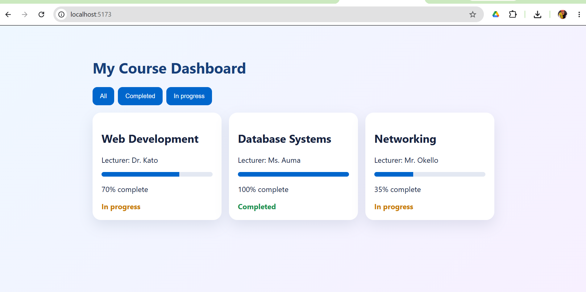
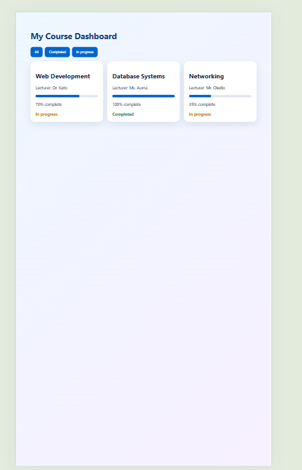

# Student Course Dashboard

A React app (built with Vite) that shows a student's courses as cards.

## Features
- Reusable `CourseCard` component that receives data through props
- Courses are stored in `src/data/courses.js` and rendered with `map()` using `course.id` as the key
- Progress bar and a Completed / In progress status on each card
- Empty state message when no courses match
- Extension feature: filter buttons (All, Completed, In progress) built with `useState`
- Responsive layout that works on phone and desktop

## Setup Instructions
1. Install Node.js from https://nodejs.org
2. Download or clone this project and open the folder in VS Code
3. Open the terminal and run:

       npm install
       npm run dev

4. Open http://localhost:5173 in your browser

## Project Structure

    src/
      components/CourseCard.jsx
      data/courses.js
      App.jsx
      main.jsx
      styles.css

## Component Tree

    App
     └── CourseCard (one for each course)

`App` holds the filter state and passes each course to `CourseCard` as a prop.

## Screenshots
Desktop view:

Phone view:

## Author
Gift Mwajuma - M25D14/011